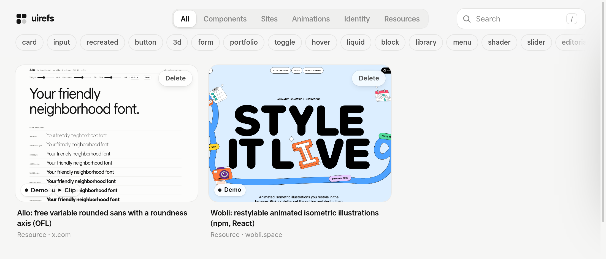

# uirefs

A self-hosted library of UI references — a component, a whole site, an animation, an identity, a resource — that the
owner browses in a web UI and agents read and write over MCP. One static Go binary, no auth (the
network is the access control). Design, data model, MCP tools and the acceptance list:
[`docs/design.md`](docs/design.md).



## Install

```sh
gh repo clone uesteibar/uirefs && cd uirefs && ./install.sh
# or, without a checkout:
curl -fsSL https://raw.githubusercontent.com/uesteibar/uirefs/main/install.sh | sh
```

Idempotent: run it again after a `git pull`. It:

- checks `git`, `curl` and a Go toolchain at least the version in `go.mod` (installs Go with `mise`
  when that is available, and never runs `sudo`);
- builds the binary with `CGO_ENABLED=0 go build -ldflags="-s -w"` and installs it to
  `${UIREFS_BIN:-~/.local/bin}/uirefs`;
- installs and starts a user service (`systemd --user` on Linux, a `launchd` agent on macOS) with the
  data in `${UIREFS_DATA:-~/.local/share/uirefs}` on `127.0.0.1:${UIREFS_PORT:-4880}`;
- waits for `GET /api/references` and runs `uirefs doctor`;
- registers the MCP server in the clients it finds on `PATH` (`claude`, `codex`, `hermes`, `pi`), each
  behind a yes/no question, then runs a real JSON-RPC smoke test (`initialize`, `tools/list`, `guide`).

**If you are a coding agent:** run `./install.sh --yes`, then call the MCP `guide` tool before saving
or searching references.

Flags: `--port N`, `--data DIR`, `--no-service`, `--no-mcp`, `--mcp claude,codex,hermes,pi`, `--yes`,
`--force`, `--dry-run`, `-h`. Environment: `UIREFS_BIN`, `UIREFS_DATA`, `UIREFS_PORT`, `UIREFS_UNIT`,
`UIREFS_PUBLIC_URL` (the URL agents should use, for example a private HTTPS name; the MCP URL is
`<UIREFS_PUBLIC_URL>/mcp`), `UIREFS_EMBED_URL`, `HERMES_PROFILE`. `just install` and `just uninstall`
run the same two scripts. `./uninstall.sh` removes the service, the MCP entries and the binary; it
keeps the data directory unless you pass `--purge-data`.

There is no authentication: keep the service on localhost or a private network. Exposing it (a
tailnet name, a proxy) is your step, and anyone who reaches it can read and delete references.

The service answers only to `localhost`, IP addresses and the host in `UIREFS_PUBLIC_URL` (more names:
`UIREFS_ALLOWED_HOSTS`, comma separated); any other `Host` gets a 403, which stops DNS rebinding from a web
page. `POST /mcp` refuses cross-origin and non-JSON requests. An MCP caller can make `add` read a local file
or fetch a URL as an asset: that is a feature for your agents, so only connect agents you trust.

## Build

```sh
just build          # CGO_ENABLED=0 go build -o uirefs ./cmd/uirefs
just check          # go vet ./... && go test ./...
```

Go comes from `mise.toml`; run `mise install` in a fresh checkout if `go` is missing.

## Run

```sh
./uirefs serve --port 4880 --data ./data
```

- Web UI: `http://127.0.0.1:4880/`
- MCP: `http://127.0.0.1:4880/mcp` (streamable HTTP, no auth)

`--data` holds the SQLite file and every asset, and is the only state; default `./data`.
Other commands: `uirefs reindex --data DIR`, `uirefs doctor --data DIR` and `uirefs version`.

## Search

Keyword search (SQLite FTS5) is always on. Semantic search is optional: point `UIREFS_EMBED_URL` at an
OpenAI-compatible `/v1/embeddings` endpoint, then run `uirefs reindex` once — and again after changing
the endpoint or model. With the variable unset, nothing about embeddings is loaded, and with the
endpoint down search still answers from keywords.

```sh
UIREFS_EMBED_URL=http://127.0.0.1:48900/v1/embeddings ./uirefs serve --port 4880 --data ./data
UIREFS_EMBED_URL=http://127.0.0.1:48900/v1/embeddings ./uirefs reindex --data ./data
```

`sidecar/` is a small local implementation of that endpoint (Xenova/all-MiniLM-L6-v2, int8), and
`deploy/` has the unit template the installer renders. `tools/mock/` is a mock of the JSON API for
working on the web UI without a service.

## License

MIT, see [`LICENSE`](LICENSE). The UI uses the [Allo](https://allo.joshpuckett.me/) typeface by Josh Puckett
(SIL Open Font License 1.1, see [`web/fonts/OFL.txt`](web/fonts/OFL.txt) and
[`THIRD_PARTY_NOTICES.md`](THIRD_PARTY_NOTICES.md)).
